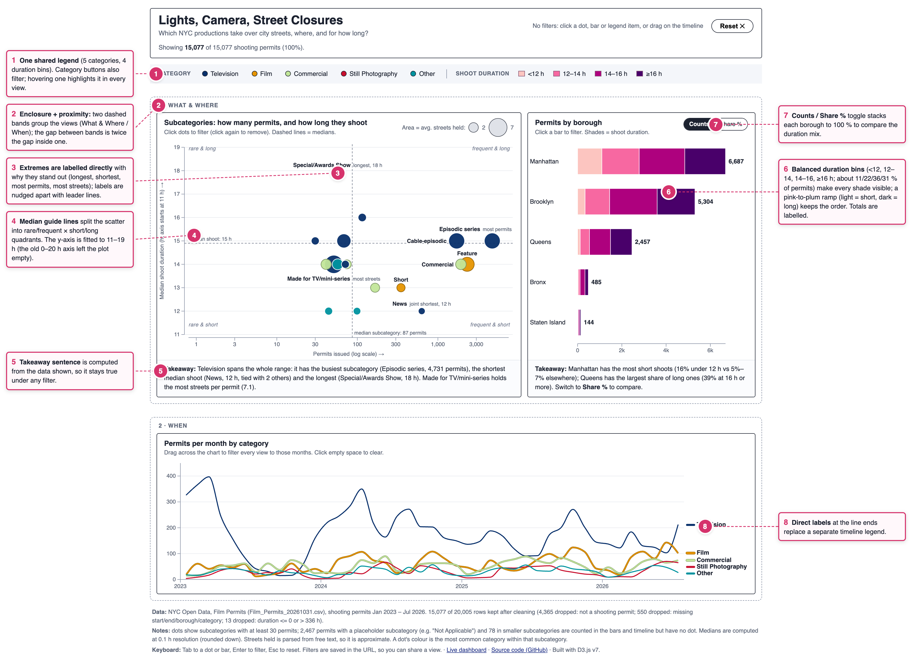

# NYC Film Permits: Lights, Camera, Street Closures
Mini-Project 2 final submission · Information Visualization, NYU Tandon

**Live dashboard:** https://gurleen-kaur1313.github.io/film-permits-dashboard/
**Repository:** https://github.com/gurleen-kaur1313/film-permits-dashboard

An interactive D3 dashboard with three linked views of the NYC Open Data **Film Permits** dataset (ID `tg4x-b46p`):
15,077 shooting permits from Jan 2023 to Jul 2026.



| # | View | Research question | Encoding |
|---|---|---|---|
| 1 | Subcategory scatter | RQ1 footprint: which productions are frequent but short, and which are rare but long and street-heavy? | x = permits (log), y = median shoot duration, area = avg. streets held, hue = category; median guide lines + quadrant captions |
| 2 | Borough bars | RQ2 geography: how do permits and shoot lengths differ by borough? | length = permits (or % in Share view), lightness = duration bin (pink-to-plum ramp) |
| 3 | Monthly timeline | RQ3 time: how did volume change, and did every category move the same way? | x = month, y = permits, hue = category; drag to brush a date range |

## Deliverables in this repo
| Deliverable | File |
|---|---|
| Interactive dashboard | [`index.html`](index.html) (live link above) |
| Usability test report | [`USABILITY_REPORT.md`](USABILITY_REPORT.md) |
| Reflection (1 page) + channel justification table | [`REFLECTION.md`](REFLECTION.md) |
| Prototype feedback and response | [`FEEDBACK_LOG.md`](FEEDBACK_LOG.md) |
| Annotated screenshots | [`screenshots/`](screenshots/) (`01_…`, `02_…`, `03_…`; before/after pairs; `greyscale_check.png`) |
| Source code | `index.html`, `prep_data.py` |

## Interactions
- **Click** a scatter dot (subcategory), a borough bar, or a category in the legend to filter. Click again to remove it. Multiple selections combine.
- **Drag** across the timeline to filter to a date range (it snaps to whole months). Click empty space on it to clear.
- **Hover** anything for details. Hovering a legend category highlights it in every view.
- **Counts / Share %** toggle on the borough bars.
- **Chips** in the header show every active filter. ✕ removes one, **Reset** or **Esc** clears all.
- **Keyboard:** Tab to a dot or bar, Enter or Space to toggle it.
- **Shareable views:** the filters are stored in the URL hash, e.g. `#b=Manhattan&r=2024-01_2024-12`.

Each view ignores the filter on its own dimension (standard cross-filtering), so you can still see and switch to the
other options: the scatter shows every subcategory, the bars every borough, and the timeline the whole time range.

## Run it locally
```bash
python3 -m http.server 8000     # in this folder
# open http://localhost:8000
```
A browser blocks `fetch()` from a `file://` page. If you open `index.html` directly, it shows a file picker for `data/permits_clean.csv`.

### Rebuilding the data (optional)
The cleaned data is already committed. To rebuild it from a fresh download:
1. Download the CSV from NYC Open Data (search "Film Permits", ID `tg4x-b46p`), e.g.
   `https://data.cityofnewyork.us/api/v3/views/tg4x-b46p/export.csv?accessType=DOWNLOAD`
2. `pip install pandas`, then `python3 prep_data.py path/to/download.csv`. This writes `data/permits_clean.csv` + `data/meta.json`
   and prints the column mapping and how many rows were dropped and why.

## Cleaning rules (also shown in the dashboard footer)
Only `Shooting Permit` events are kept (`--all-types` keeps all); rows missing start, end, borough or category are dropped;
durations <= 0 or > 336 h are dropped; streets = number of "between" segments in the free-text ParkingHeld column (approximate).
Category = top 4 by permit count + "Other". Placeholder subcategories such as "Not Applicable" (2,467 permits, almost all Still
Photography) and subcategories with fewer than 30 permits get no scatter dot but are still counted in the bars and timeline.

## How the code works
- `prep_data.py`: matches column names ignoring case and spaces, parses dates, computes duration and street count, writes a small CSV.
- `index.html` is organised in numbered sections (see the comment block at the top):
  - `indexData()` turns rows into typed arrays (category, borough, subcategory, month, duration bin, 0.1 h histogram bin).
  - `state` is the one object holding the active filters. Every interaction edits it and calls `render()`. `writeHash()`/`readHash()` mirror it in the URL.
  - `compute()` makes a single pass over all rows that builds the data for all three views. Medians come from a 0.1 h histogram per subcategory, which keeps brushing smooth.
  - `layout()` draws each SVG at its real pixel width and rebuilds on window resize, so text stays readable from phone to desktop.
  - `renderScatter / renderBars / renderTimeline` are D3 joins with 250 ms transitions (off while dragging the brush).
  - `renderLabels()` places labels greedily: it tries positions around each dot, rejects overlaps, and adds a leader line when a label has to move away.
  - `renderTakeaway()` / `renderBarsTakeaway()` write the one-line takeaways from the data currently shown.

## Changes since the working prototype
See [`FEEDBACK_LOG.md`](FEEDBACK_LOG.md) for the full list. In short: the scatter y-axis is fitted to the data (11–19 h),
labels no longer overlap, the extremes are labelled, and median guide lines give quadrant captions. There is a new
colour-blind-safe palette with clear lightness steps, rebalanced duration bins plus a Share % view, and data-driven
takeaways. Also new: keyboard access, a responsive layout, shareable URLs, and live links.

## Credits
D3.js v7 (Mike Bostock, ISC license) · NYC Open Data, Mayor's Office of Media and Entertainment ·
Palette hues adapted from ColorBrewer / Paul Tol, checked with Machado et al. (2009) colour-vision simulation ·
AI assistance: Claude (Anthropic) was used to help write and revise the code and documentation.
