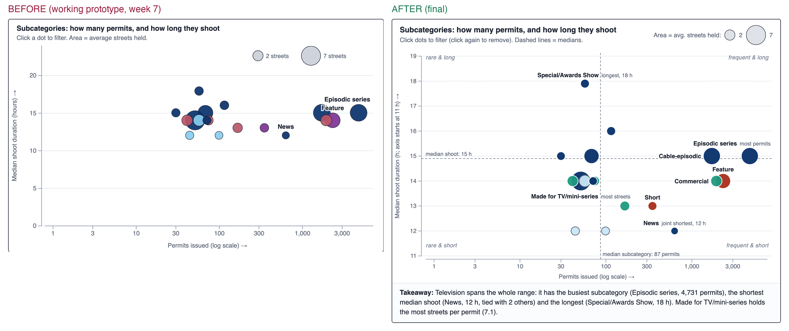

# Usability Test Report: NYC Film Permits Dashboard
Mini-Project 2 · Information Visualization, NYU Tandon
Live dashboard: https://gurleen-kaur1313.github.io/film-permits-dashboard/ · Repo: https://github.com/gurleen-kaur1313/film-permits-dashboard

> **To complete before submitting:** every `[ ]` field below must be filled in from the two real test sessions.
> Tasks, success criteria and expected answers are already set; record what testers actually did and said.

## 1. Method
- **Participants:** 2 peers who had **not** seen the dataset before (course tip). P1: `[program / year]`; P2: `[program / year]`.
- **Setup:** live dashboard in `[browser]` on a `[laptop / screen size]`, opened with no filters. Each tester got one
  sentence of context: *"This shows NYC film-shoot permits: what kind of production, which borough, when, and how long."*
  No tour of the controls.
- **Protocol:** think-aloud. I read each task aloud, then timed it, noted the path taken, errors, hesitations and direct quotes.
  I did not help unless the tester was stuck for more than 60 s (logged as an "assist").
- **Measures per task:** success (yes / partial / no), time, number of wrong clicks, assists, quotes.
  After the tasks: "What was the most confusing thing?" and "What would you change?"
- **Date(s):** `[ ]`

## 2. Tasks
Each task targets one research question and forces use of a different view and interaction.

| Task | Wording given to the tester | Tests | Expected answer (from the data) |
|---|---|---|---|
| **T1** (RQ1, scatter + legend) | "Among **Television** productions, which kind of shoot has the **longest typical shoot**, and about how many permits does it have?" | Reading position on the y-axis, legend filtering, tooltip | **Special/Awards Show**: median 18 h, 57 permits |
| **T2** (RQ2, bars + toggle) | "What **share of Brooklyn's** shoots last **16 hours or more**? Which borough has the **largest share of short shoots** (under 12 h)?" | Finding and using the Share % toggle, reading the duration legend | **32 %**; **Manhattan** (16 % under 12 h) |
| **T3** (RQ3, linked brushing) | "Look only at **Film** permits during **2025**. Which **borough** had the most of them, and which **Film subcategory** dominates?" | Combining a legend filter with a timeline brush, reading the other views | 808 Film permits in 2025: **Manhattan** (355) and **Feature** (707) |

## 3. Raw observations

### Participant 1
| Task | Success | Time | Wrong clicks / assists | What they did (path) | Quotes |
|---|---|---|---|---|---|
| T1 | `[ ]` | `[ ]` | `[ ]` | `[ ]` | `[ ]` |
| T2 | `[ ]` | `[ ]` | `[ ]` | `[ ]` | `[ ]` |
| T3 | `[ ]` | `[ ]` | `[ ]` | `[ ]` | `[ ]` |

Most confusing thing (their words): `[ ]` · What they would change: `[ ]`

### Participant 2
| Task | Success | Time | Wrong clicks / assists | What they did (path) | Quotes |
|---|---|---|---|---|---|
| T1 | `[ ]` | `[ ]` | `[ ]` | `[ ]` | `[ ]` |
| T2 | `[ ]` | `[ ]` | `[ ]` | `[ ]` | `[ ]` |
| T3 | `[ ]` | `[ ]` | `[ ]` | `[ ]` | `[ ]` |

Most confusing thing (their words): `[ ]` · What they would change: `[ ]`

### Summary
| Task | P1 | P2 | Mean time |
|---|---|---|---|
| T1 | `[ ]` | `[ ]` | `[ ]` |
| T2 | `[ ]` | `[ ]` | `[ ]` |
| T3 | `[ ]` | `[ ]` | `[ ]` |

## 4. Identified issues
Rate severity as **High** (blocks the task), **Medium** (slows the task or causes errors) or **Low** (cosmetic).
Watch especially for: whether testers notice the **Share %** toggle without help, whether they realise the dot
**colour** is the subcategory's most common category, whether they find the **brush** on the timeline, and whether
the **log** x-axis or the **non-zero** y-axis confuses them.

| # | Issue (what happened) | Seen in | Severity | Root cause (visualization principle) |
|---|---|---|---|---|
| U1 | `[ ]` | `[P1/P2, task]` | `[ ]` | `[ ]` |
| U2 | `[ ]` | `[ ]` | `[ ]` | `[ ]` |
| U3 | `[ ]` | `[ ]` | `[ ]` | `[ ]` |

## 5. Design changes made in response

### 5a. Changes from the prototype review (already done; before/after below)
| Issue | Change |
|---|---|
| Scatter y-axis 0–20 h left the plot empty; labels overlapped | y-axis fitted to the data (11–19 h, axis title says where it starts); collision-free labels with leader lines |
| Navy / purple / maroon hard to tell apart at small sizes | new palette with L\* steps 21 / 39 / 57 / 72 / 90 and distinct hues; white dot outlines; 5 px minimum radius |
| 12–24 h bin was 80–90 % of every bar, so the other shades were invisible | rebalanced bins (<12 / 12–14 / 14–16 / ≥16 h, about 11/22/36/31 %), Counts / Share % toggle, totals kept as labels |
| "Television is frequent and short / rare and long" had no visual cue | extremes labelled with the reason they are extreme; median guide lines with quadrant captions; data-driven takeaway. The claim was reworded after checking the data. |

**Before / after: scatter**

**Before / after: borough bars**

### 5b. Changes from these usability tests
| Issue | Change made | Before / after evidence |
|---|---|---|
| U1 | `[ ]` | `[screenshot]` |
| U2 | `[ ]` | `[screenshot]` |

## 6. What worked well
`[ ]` (e.g. which interactions testers found without help, which tasks were fast)
