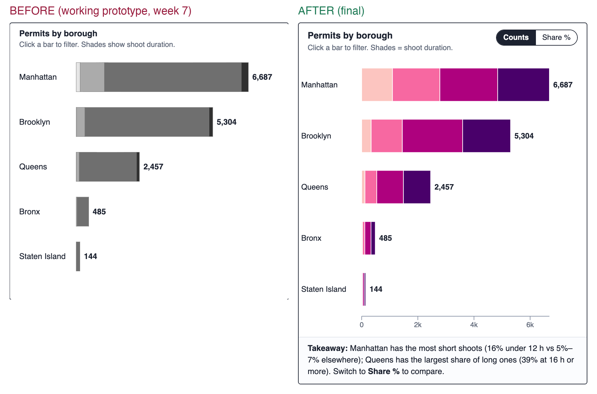
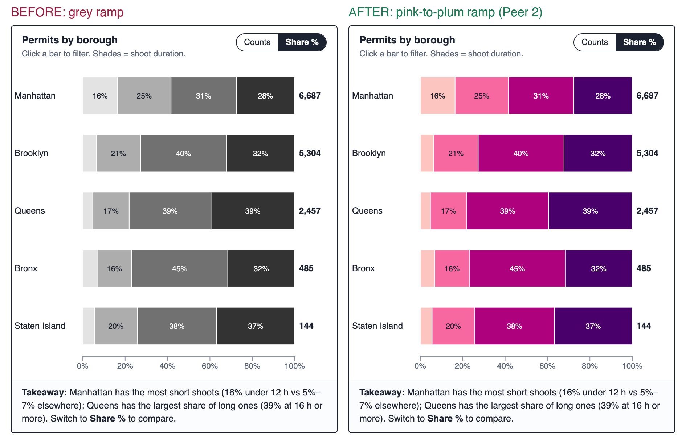

# Usability Test Report: NYC Film Permits Dashboard
Mini-Project 2 · Information Visualization, NYU Tandon
Live dashboard: https://gurleen-kaur1313.github.io/film-permits-dashboard/ · Repo: https://github.com/gurleen-kaur1313/film-permits-dashboard

## 1. Method
- **Participants:** 2 peers. Peer 1: `[program / year]`; Peer 2: `[program / year]`.
- **Setup:** the working prototype (week 7) on a laptop, opened with no filters. Each peer got one sentence of
  context: *"This shows NYC film-shoot permits: what kind of production, which borough, when, and how long."*
- **Protocol:** each peer explored the dashboard while thinking aloud and worked through the three tasks below.
  I took notes on what they said and where they hesitated, then asked: "What was the most confusing thing?" and
  "What would you change?"
- **Date(s):** `[ ]`

## 2. Tasks
Each task targets one research question and needs a different view and interaction.

| Task | Wording given to the tester | Tests | Expected answer (from the data) |
|---|---|---|---|
| **T1** (RQ1, scatter + legend) | "Among **Television** productions, which kind of shoot has the **longest typical shoot**, and about how many permits does it have?" | Reading position on the y-axis, legend filtering, tooltip | **Special/Awards Show**: median 18 h, 57 permits |
| **T2** (RQ2, bars) | "What **share of Brooklyn's** shoots last **16 hours or more**? Which borough has the **largest share of short shoots** (under 12 h)?" | Reading the duration shades and the duration legend | **32 %**; **Manhattan** (16 % under 12 h) |
| **T3** (RQ3, linked brushing) | "Look only at **Film** permits during **2025**. Which **borough** had the most of them, and which **Film subcategory** dominates?" | Combining a legend filter with a timeline brush, reading the other views | 808 Film permits in 2025: **Manhattan** (355) and **Feature** (707) |

## 3. Raw observations

### Peer 1
**What worked (their words):** "Very deliberate encoding choices … position for counts and duration, area
(square-root scaled) for streets held, hue for category, an ordered grey ramp for duration bins, and a colour-blind-safe
palette." They also noted that "filtering is linked across all three views (click a dot, click a borough, brush the
timeline), filter chips show what is active, and the data note documents the cleaning."

| View / task | Observation | Quote |
|---|---|---|
| Scatter (T1) | Most of the plot area was empty; the dots were squeezed into a narrow band, and two labels sat on top of each other. | "The scatter y-axis runs 0-20 h but nearly all dots sit between 12 and 18 h, so the plot is mostly empty … resolve overlapping labels ('Episodic series' / 'Feature')." |
| Scatter (T1) | Could not reliably tell the category colours apart on the small dots. | "The dark navy, purple and maroon category hues are hard to tell apart at small dot sizes." |
| Borough bars (T2) | One duration shade filled almost every bar, so the other bins could not be read. | "In the borough bars the 12-24 h bin dominates (80-90%), so the grey shades for the minor bins are barely visible; consider a 100% stacked view … and keep absolute totals as labels." |
| Scatter (T1) | Could not see the evidence for the narrated claim about Television. | "The claim that Television is both 'frequent and short' and 'rare and long' needs a clearer visual cue, e.g. labels on the extreme subcategories." |
| Hand-in | The live dashboard and the repository were not linked. | "Make sure the final hand-in links the live dashboard and repository." |

Time and success per task: `[not recorded]`

### Peer 2
| View / task | Observation | Quote |
|---|---|---|
| Borough bars (T2) | Found the grey duration shades hard to tell apart and did not think they stood out from the rest of the dashboard. | Paraphrase: the grey shades should be changed to some other, more distinctive, bright colours. |

Other observations, time and success per task: `[add if recorded]`

## 4. Identified issues
| # | Issue | Seen by | Severity | Root cause (visualization principle) |
|---|---|---|---|---|
| U1 | Scatter mostly empty; dots compressed into a narrow band; overlapping labels | Peer 1 | Medium | The y-domain started at 0, which wasted position (the most effective channel) on 0–11 h, where there is no data. |
| U2 | Category hues confusable at small dot sizes | Peer 1 | High (affects T1) | Navy, purple and maroon were too close in **lightness** (L\* 21 / 35 / 50); hue alone is a weak cue for small marks. |
| U3 | Minor duration bins invisible in the borough bars | Peers 1 and 2 | High (blocks T2) | Unbalanced bins (85 % of permits in one bin), so the other segments were only slivers. |
| U4 | Grey duration shades hard to distinguish and visually dull | Peer 2 | Medium | Four close greys have low salience and differ only in lightness; nothing separates them from the dashboard's grey UI (axes, text, borders). |
| U5 | The Television claim was not visible in the chart | Peer 1 | Medium | The key marks had no direct labels and there was no reference for "frequent" or "long". |
| U6 | Live dashboard and repo not linked | Peer 1 | Low | Missing provenance and access links. |

## 5. Design changes made in response
| Issue | Change made |
|---|---|
| U1 | The y-axis is fitted to the data (11–19 h); the axis title says where it starts. Labels are placed by a collision-checking routine, with leader lines when a label has to move away from its dot. |
| U2 | Final palette: blue #08306B (Television), golden orange #E69500 (Film), light green #C2E699 (Commercial), crimson red #C8102E (Still Photography) and teal #00939F (Other). Five clearly different hues, each at a different lightness (L\* 21 / 43 / 56 / 68 / 87, every step ≥ 12.8), so they also separate in greyscale. Red and orange are kept far apart in both hue and lightness. The worst-case pair under simulated protan / deutan / tritan vision is ΔE 38.1 / 38.1 / 39.0, up from 14.1 in the prototype. Dots have a white outline (a darker edge of their own hue for the light orange and green) and a 5 px minimum radius. Greyscale evidence: `screenshots/greyscale_check.png`. |
| U3 | Bins rebalanced to <12 / 12–14 / 14–16 / ≥16 h (about 11 / 22 / 36 / 31 % of permits). A **Counts / Share %** toggle stacks each borough to 100 %, with % labels inside segments and totals kept as labels. |
| U4 | The grey ramp became a bright **pink-to-plum sequential ramp** (ColorBrewer RdPu: #FCC5C0 → #F768A1 → #AE017E → #49006A). I took the advice to use bright, distinctive colours, but kept them as **one ordered ramp** rather than four unrelated hues. Duration bins are ordinal, so by the Expressiveness principle the colour must also look ordered. Lightness still falls steadily (L\* 84 / 64 / 39 / 18), so the order survives greyscale and colour-blindness. None of these hues are used by the category palette, so duration and category can't be confused. |
| U5 | The extremes are labelled with the reason they stand out; dashed median lines and quadrant captions added; data-driven takeaway sentence. Checking the data reworded the claim: Television spans the whole range (busiest: Episodic series; joint shortest: News, 12 h; longest: Special/Awards Show, 18 h). |
| U6 | The live dashboard and repo are linked in the README, the dashboard footer, and this report. |

**Before / after: scatter (U1, U2, U5)**

**Before / after: borough bars (U3)**

**Before / after: duration colours (U4, Share % view)**

## 6. What worked well
Both peers could use the linked filtering. Peer 1 specifically praised the encoding choices, the linked filtering across
all three views, the filter chips, and the documented data cleaning. All of these were kept unchanged in the final version.
